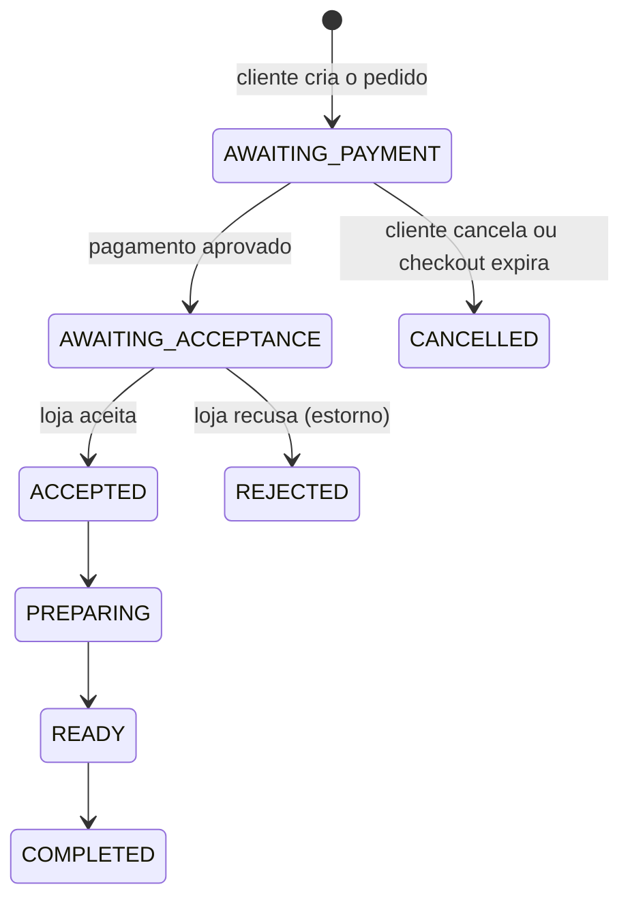
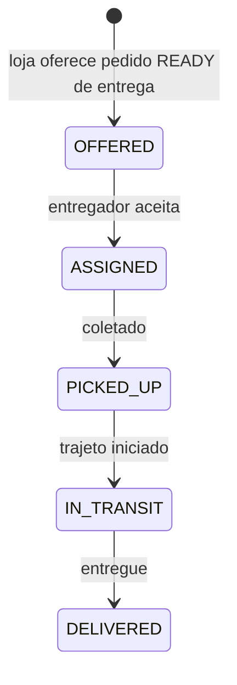

# FoodDelivery — como o projeto funciona

Plataforma de pedidos, reservas e entregas para cidades pequenas e comércios locais. Este documento descreve o que o código faz hoje; o que depende de configuração externa está marcado como tal. Documentos complementares: `Modelo_de_Dados.md` (tabelas e regras de integridade) e `Visao_e_Especificacao_do_Produto.md` (visão de produto).

## 1. Visão geral

| Camada | Tecnologia | Pasta |
|---|---|---|
| Interface web | JavaScript puro (módulo ES), sem framework, servido por um script Python | `Frontend/` |
| API | Java 21, Spring Boot 3.5, Spring Security (JWT), Spring Data JPA | `Backend/` |
| Banco | PostgreSQL (padrão), H2 em arquivo no perfil `dev-h2`; migrações Flyway V1 a V11 | `Backend/src/main/resources/db/migration` |
| Pagamento | Mercado Pago (Marketplace + Checkout Pro) | `payments/` |
| Imagens de capa por IA | API de imagens da OpenAI (opcional) | `catalog/StoreImageAiController` |
| Inicialização local | `npm start` roda `scripts/dev.py`: sobe banco, API e interface juntos | raiz |

A interface fala com a API em `/api/v1`. Em desenvolvimento a interface roda em `127.0.0.1:5173` e a API em `127.0.0.1:8080`.

## 2. Papéis e permissões

Existem quatro papéis: `CUSTOMER`, `MERCHANT`, `COURIER` e `ADMIN`.

- Todo cadastro público cria uma conta de **cliente**. O CPF é obrigatório, validado e único.
- Vendedor e entregador **pedem acesso profissional** vinculado à conta existente (`POST /account/operator-applications`) ou no cadastro (`POST /auth/operator-applications`). O administrador aprova ou recusa em `/admin/operator-applications/{id}/approve|reject`. Enquanto o pedido está pendente, a conta continua ativa como cliente.
- Uma conta pode ter vários papéis concedidos (`granted_roles`) e escolhe o perfil ativo na interface. O administrador pode suspender um papel sem afetar os demais (`suspended_roles`).
- O administrador pode suspender a conta inteira e gerar senha temporária; a pessoa precisa trocá-la no próximo acesso (`password_change_required`).
- Trocar ou redefinir a senha incrementa `credential_version`, o que invalida os tokens anteriores.
- Cada requisição autenticada valida assinatura, emissor e validade do JWT e confirma que a conta continua ativa.

## 3. Fluxo de compra (pedido)

1. O cliente monta o carrinho de uma loja, escolhe **retirada** ou **entrega**, informa o endereço (entrega) e uma **observação opcional de até 500 caracteres**.
2. `POST /orders` cria o pedido em `AWAITING_PAYMENT`, congela subtotal, taxa de entrega e total e reserva o estoque.
3. `POST /payments/{id}/checkout` abre o checkout do Mercado Pago. O retorno é confirmado por `POST /payments/{id}/sync` e pelo webhook `POST /webhooks/mercadopago`, que exige assinatura válida.
4. Com o pagamento aprovado o pedido vai para `AWAITING_ACCEPTANCE` e a loja passa a vê-lo em `/merchant/orders`. **Pedidos ainda não pagos não aparecem para a loja.**
5. A loja atualiza o estado em `PATCH /merchant/orders/{id}/status`; cada mudança notifica o cliente. Recusar ou cancelar um pedido pago repõe o estoque e solicita o estorno integral.
6. A cada 60 segundos o `UnpaidCheckoutExpirationJob` cancela pedidos e reservas cujo pagamento não foi concluído, libera estoque ou horário e avisa as partes.

O cliente pode cancelar enquanto o pagamento não foi aprovado (`POST /orders/{id}/cancel`). Depois do pagamento, o cancelamento é feito pela loja.

## 4. Fluxo de reserva

`PENDING_PAYMENT → CONFIRMED → IN_SERVICE → COMPLETED`, com `CANCELLED` e `NO_SHOW` como saídas.

- `POST /reservations` recebe loja, serviço, horário (mínimo de 30 minutos de antecedência) e **comentário opcional de até 500 caracteres**.
- A tabela `reservation_slots` impede dois clientes no mesmo horário da mesma loja. O horário é liberado ao cancelar, expirar, concluir ou marcar falta.
- O pagamento segue o mesmo caminho do pedido. A loja vê a reserva somente depois do pagamento (`/merchant/reservations`) e a atualiza em `PATCH /merchant/reservations/{id}`.
- Cancelar uma reserva paga pela loja solicita o estorno integral.

## 5. Mensagens e comentários

| Recurso | Quem participa | Quando está aberto | Endpoints |
|---|---|---|---|
| Conversa do pedido | Cliente e dono da loja | Depois do pagamento e até o pedido terminar (`COMPLETED`, `REJECTED`, `CANCELLED`) | `GET/POST /orders/{id}/messages` |
| Conversa da reserva | Cliente e dono da loja | Depois do pagamento e até a reserva terminar (`COMPLETED`, `CANCELLED`, `NO_SHOW`) | `GET/POST /reservations/{id}/messages` |
| Chat com o entregador | Cliente do pedido e entregador atribuído | Somente com a entrega em `ASSIGNED`; encerra na coleta (`PICKED_UP`) | `GET/POST /deliveries/{id}/messages` |

Regras comuns:

- Cada mensagem tem de 1 a 1000 caracteres. Cada conversa devolve as últimas 100 mensagens em ordem cronológica.
- Quem não participa recebe acesso negado. A loja não acessa a conversa de pedido ou reserva ainda não paga.
- Depois que a conversa encerra, o histórico continua legível para os participantes, mas novas mensagens são recusadas.
- Cada mensagem gera uma notificação para a outra parte. Enquanto a pessoa não lê a anterior, não é criada outra com o mesmo título, para não encher a lista.
- A observação do cliente aparece para a loja e, no caso de entrega, também para o entregador depois do aceite. Ela deixa de ser exposta ao entregador quando a entrega é concluída.

Na interface, o painel de conversa atualiza a lista de mensagens a cada 5 segundos sem recriar a página, o que preserva o texto em digitação. O rascunho é guardado por conversa. Sair da conta, expirar a sessão ou trocar de página para o polling e limpa as conversas da memória.

## 6. Entrega

- A loja oferece um pedido de entrega que esteja `READY` (`POST /merchant/orders/{id}/delivery`).
- Entregadores veem ofertas sem endereço nem dados do cliente. Esses dados aparecem depois do aceite (`POST /courier/offers/{id}/accept`). O aceite é uma atualização condicional atômica: só um entregador consegue a oferta.
- O entregador avança o estado em `PATCH /courier/deliveries/{id}`. Só as transições da figura são aceitas.
- Durante `IN_TRANSIT` o entregador pode compartilhar a localização (`PATCH /courier/deliveries/{id}/location`). O cliente vê o trajeto e pode abrir o mapa externo.
- O botão do chat com o entregador só aparece depois que há entregador atribuído. Depois da coleta, ambos mantêm o histórico em modo leitura.

## 7. Lojas, catálogo e pagamentos

- Cada loja tem categoria, endereço, **cidade e estado** (usados para filtrar lojas pela cidade do cliente), capa, taxa fixa de entrega (R$ 0,00 a R$ 1.000,00) e comissão do marketplace (0% a 50%, definida pelo administrador).
- Lojas novas precisam de aprovação do administrador antes de aparecer.
- A capa pode ser enviada como arquivo (`POST /merchant/stores/{id}/cover`) ou gerada por IA (`POST /merchant/stores/{storeId}/ai/cover`, limite de 5 imagens por hora por conta).
- A loja conecta a conta do Mercado Pago por OAuth (`/merchant/stores/{storeId}/mercadopago/connect`). Os tokens ficam criptografados no banco.
- Estornos usam chave de idempotência. Tentativas que falham entram na rotina de repetição (`RefundRetryJob`) e, esgotadas, em `REFUND_REVIEW` para ação do administrador (`GET /admin/refunds`).

## 8. Notificações

- Mensagens importantes (pedido, pagamento, aprovação, mensagem nova) são gravadas por conta em `account_notifications` e ficam até a pessoa limpar (`DELETE /account/notifications`).
- A interface consulta `/account/notifications` a cada 30 segundos com a aba visível e mostra as novas como aviso temporário.
- Confirmações e erros da própria interface são avisos temporários e não são gravados.

## 9. Mapa da API

Todas as rotas começam com `/api/v1`. Públicas: cadastro, login, pedido de acesso profissional, categorias, imagens de loja, retorno e webhook do Mercado Pago, `/status` e `/actuator/health`. As demais exigem token.

| Grupo | Rotas principais |
|---|---|
| Autenticação | `POST /auth/register`, `/auth/login`, `/auth/operator-applications` |
| Conta | `GET /account/me`, `PUT /account/profile`, `POST /account/password`, `POST /account/operator-applications`, `/account/addresses` (CRUD e padrão), `/account/notifications` |
| Catálogo | `GET /stores`, `GET /stores/{id}/items`, `/merchant/stores`, `/merchant/items/{id}` |
| Pedidos | `POST /orders`, `GET /orders/mine`, `POST /orders/{id}/cancel`, `GET /merchant/orders`, `PATCH /merchant/orders/{id}/status` |
| Reservas | `POST /reservations`, `GET /reservations/mine`, `POST /reservations/{id}/cancel`, `GET /merchant/reservations`, `PATCH /merchant/reservations/{id}` |
| Entregas | `/merchant/orders/{id}/delivery`, `/courier/offers`, `/courier/deliveries` |
| Mensagens | `/orders/{id}/messages`, `/reservations/{id}/messages`, `/deliveries/{id}/messages` |
| Pagamentos | `/payments/{id}`, `/payments/{id}/checkout`, `/payments/{id}/sync`, `/webhooks/mercadopago`, `/merchant/stores/{storeId}/mercadopago/*` |
| Administração | `/admin/stores`, `/admin/accounts`, `/admin/operators`, `/admin/operator-applications`, `/admin/refunds` |
| Somente `dev-h2` | `/dev/payments/{id}/approve`, `/dev/reservations/{id}/approve-payment` simulam o pagamento sem o Mercado Pago |

## 10. Configuração e execução

Variáveis em `Backend/.env.example` (copie para `.env`; nunca versione valores reais):

| Variável | Para que serve | Obrigatória |
|---|---|---|
| `DATABASE_URL`, `DATABASE_USERNAME`, `DATABASE_PASSWORD` | Banco PostgreSQL | Sim (perfil `postgres` e `prod`) |
| `JWT_SECRET` | Assinatura dos tokens | Sim em produção |
| `APP_ADMIN_EMAIL`, `APP_ADMIN_PASSWORD` | Administrador inicial | Sim na primeira execução |
| `MP_CLIENT_ID`, `MP_CLIENT_SECRET`, `MP_REDIRECT_URI`, `MP_TOKEN_ENCRYPTION_KEY`, `MP_WEBHOOK_SECRET`, `MP_NOTIFICATION_BASE_URL`, `MP_SANDBOX` | Mercado Pago | Sim para pagamentos reais |
| `OPENAI_API_KEY`, `OPENAI_IMAGE_MODEL` | Geração de capa por IA | Não; sem chave a rota responde indisponível |
| `STORE_ASSETS_DIR` | Pasta das capas | Não |

Perfis: `postgres` (padrão), `dev-h2` (banco em arquivo e rotas de pagamento simulado) e `prod`.

Execução local: `npm start` na raiz. Docker: `Backend/Dockerfile` usa Java 21, a mesma versão do `pom.xml`.

## 11. Pontos que dependem de configuração externa

- Mercado Pago: credenciais reais ou de teste, URL pública para webhook e homologação do estorno automático.
- OpenAI: chave de API; sem ela a geração de capa não funciona.
- Produção: `JWT_SECRET` forte, banco próprio, HTTPS e domínio para o retorno do pagamento.

## 12. Limites conhecidos

- Não há testes automatizados de ponta a ponta nem testes da interface; existe uma classe de testes unitários do chat (`OperationMessageControllerTest`).
- Reservas usam horário pontual: sem duração, grade nem capacidade por profissional.
- Não há indicador de "não lido" por conversa; o aviso de mensagem nova chega pela notificação.
- A geração de capa por IA usa um único modelo e provedor, sem repetição nem alternativa em caso de falha.
- Conciliação contábil, chargebacks e saque iniciado pela plataforma não existem.
