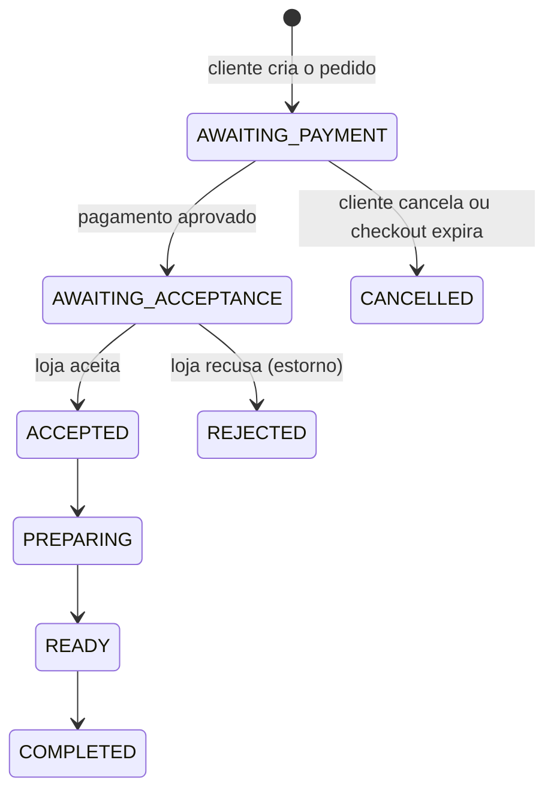
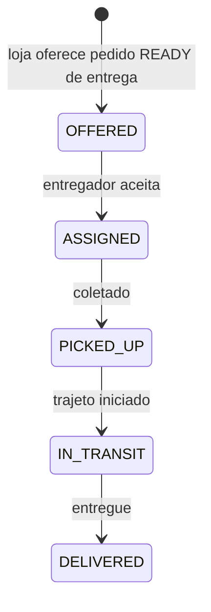

# FoodDelivery — como o projeto funciona

Plataforma de pedidos, reservas e entregas para cidades pequenas e comércios locais. Este documento descreve o que o código faz hoje; o que depende de configuração externa está marcado como tal. Documentos complementares: `Modelo_de_Dados.md` (tabelas e regras de integridade) e `Visao_e_Especificacao_do_Produto.md` (visão de produto).

## 1. Visão geral

| Camada | Tecnologia | Pasta |
|---|---|---|
| Interface web | JavaScript puro (módulo ES), sem framework, servido por um script Python | `Frontend/` |
| API | Java 21, Spring Boot 3.5, Spring Security (JWT), Spring Data JPA | `Backend/` |
| Banco | PostgreSQL (padrão), H2 em arquivo no perfil `dev-h2`; migrações Flyway versionadas | `Backend/src/main/resources/db/migration-common` e pastas específicas por banco |
| Pagamento | Mercado Pago (Marketplace + Checkout Pro) | `payments/` |
| Imagens de capa por IA | API de imagens da OpenAI (opcional) | `catalog/StoreImageAiController` |
| Inicialização local | `npm start` roda `scripts/dev.py`: sobe banco, API e interface juntos | raiz |

A interface fala com a API em `/api/v1`. Em desenvolvimento a interface roda em `127.0.0.1:5173` e a API em `127.0.0.1:8080`.

## 2. Papéis e permissões

Existem quatro papéis: `CUSTOMER`, `MERCHANT`, `COURIER` e `ADMIN`.

- Todo cadastro público cria uma conta de **cliente**. O CPF é obrigatório, validado e único.
- Vendedor e entregador **pedem acesso profissional** vinculado à conta existente (`POST /account/platform-requests/roles`). O administrador aprova ou recusa em `/admin/platform-requests/{id}/review`. Enquanto o pedido está pendente, a conta continua ativa como cliente. As rotas antigas de `operator-applications` são compatibilidade e não criam contas novas.
- Uma conta pode ter vários papéis concedidos (`granted_roles`) e escolhe o perfil ativo na interface. O administrador pode suspender um papel sem afetar os demais (`suspended_roles`).
- O administrador pode suspender a conta inteira e gerar senha temporária; a pessoa precisa trocá-la no próximo acesso (`password_change_required`).
- O administrador não precisa de CPF. Pode corrigir dados cadastrais das contas e gerenciar a cobertura de cidades em **Definições**; CPF continua obrigatório para clientes e profissionais e permanece uma coluna opcional/única, nunca a chave primária.
- Em **Definições > Integrações**, a interface informa se as variáveis privadas de SMTP, WhatsApp, OpenAI e Mercado Pago estão presentes. Segredos são configurados no ambiente do backend e não passam pelo navegador. O indicador não representa homologação do provedor.
- Trocar ou redefinir a senha incrementa `credential_version`, o que invalida os tokens anteriores.
- A recuperação pública usa códigos de uso único enviados por SMTP ou, opcionalmente, WhatsApp Cloud. O telefone precisa ser confirmado pelo próprio titular antes da recuperação por WhatsApp.
- Cada requisição autenticada valida assinatura, emissor e validade do JWT e confirma que a conta continua ativa.

## 3. Fluxo de compra (pedido)

1. O cliente monta o carrinho de uma loja, escolhe **retirada** ou **entrega**, informa o endereço (entrega) e uma **observação opcional de até 500 caracteres**.
2. `POST /orders` cria o pedido em `AWAITING_PAYMENT`, congela subtotal, taxa de entrega e total e reserva o estoque.
3. `POST /payments/{id}/checkout` abre o checkout do Mercado Pago. O retorno é confirmado por `POST /payments/{id}/sync` e pelo webhook `POST /webhooks/mercadopago`, que exige assinatura válida.
4. Com o pagamento aprovado o pedido vai para `AWAITING_ACCEPTANCE` e a loja passa a vê-lo em `/merchant/orders`. **Pedidos ainda não pagos não aparecem para a loja.**
5. A loja atualiza o estado em `PATCH /merchant/orders/{id}/status`; cada mudança notifica o cliente. Recusar ou cancelar um pedido pago repõe o estoque e solicita o estorno integral.
6. A cada 60 segundos o `UnpaidCheckoutExpirationJob` cancela pedidos e reservas cujo pagamento não foi concluído, libera estoque ou horário e avisa as partes.

O cliente pode cancelar enquanto o pagamento não foi aprovado (`POST /orders/{id}/cancel`). Depois do pagamento, o cancelamento é feito pela loja.

## 4. Fluxo de reserva

`PENDING_PAYMENT → CONFIRMED → IN_SERVICE → COMPLETED`, com `CANCELLED` e `NO_SHOW` como saídas.

- `POST /reservations` recebe loja, serviço, horário (mínimo de 30 minutos de antecedência) e **comentário opcional de até 500 caracteres**.
- A tabela `reservation_slots` impede dois clientes no mesmo horário da mesma loja. O horário é liberado ao cancelar, expirar, concluir ou marcar falta.
- O pagamento segue o mesmo caminho do pedido. A loja vê a reserva somente depois do pagamento (`/merchant/reservations`) e a atualiza em `PATCH /merchant/reservations/{id}`.
- Cancelar uma reserva paga pela loja solicita o estorno integral.

## 5. Mensagens e comentários

| Recurso | Quem participa | Quando está aberto | Endpoints |
|---|---|---|---|
| Conversa do pedido | Cliente e dono da loja | Depois do pagamento e até o pedido terminar (`COMPLETED`, `REJECTED`, `CANCELLED`) | `GET/POST /orders/{id}/messages` |
| Conversa da reserva | Cliente e dono da loja | Depois do pagamento e até a reserva terminar (`COMPLETED`, `CANCELLED`, `NO_SHOW`) | `GET/POST /reservations/{id}/messages` |
| Chat com o entregador | Cliente do pedido e entregador atribuído | Somente com a entrega em `ASSIGNED`; encerra na coleta (`PICKED_UP`) | `GET/POST /deliveries/{id}/messages` |

Regras comuns:

- Cada mensagem tem de 1 a 1000 caracteres. Cada conversa devolve as últimas 100 mensagens em ordem cronológica.
- Quem não participa recebe acesso negado. A loja não acessa a conversa de pedido ou reserva ainda não paga.
- Depois que a conversa encerra, o histórico continua legível para os participantes, mas novas mensagens são recusadas.
- Cada mensagem gera uma notificação para a outra parte. Enquanto a pessoa não lê a anterior, não é criada outra com o mesmo título, para não encher a lista.
- A observação do cliente aparece para a loja e, no caso de entrega, também para o entregador depois do aceite. Ela deixa de ser exposta ao entregador quando a entrega é concluída.

Na interface, o painel de conversa consulta novas mensagens a cada 5 segundos enquanto está aberto e a aba está visível. As atualizações da lista não recriam o formulário, preservando o texto em digitação, e cada conversa mantém seu rascunho durante a sessão. Trocar de seção interrompe a consulta periódica; sair da conta ou expirar a sessão limpa conversas e rascunhos da memória do navegador.

## 6. Entrega

- A loja oferece um pedido de entrega que esteja `READY` (`POST /merchant/orders/{id}/delivery`).
- Entregadores veem ofertas sem endereço nem dados do cliente. Esses dados aparecem depois do aceite (`POST /courier/offers/{id}/accept`). O aceite é uma atualização condicional atômica: só um entregador consegue a oferta.
- O entregador avança o estado em `PATCH /courier/deliveries/{id}`. Só as transições da figura são aceitas.
- Durante `IN_TRANSIT` o entregador pode compartilhar a localização (`PATCH /courier/deliveries/{id}/location`). O cliente vê o trajeto e pode abrir o mapa externo.
- O botão do chat com o entregador só aparece depois que há entregador atribuído. Depois da coleta, ambos mantêm o histórico em modo leitura.

## 7. Lojas, catálogo e pagamentos

- Cada loja tem categoria, endereço, **cidade e estado** (usados para filtrar lojas pela cidade do cliente), capa, taxa fixa de entrega (R$ 0,00 a R$ 1.000,00) e comissão do marketplace (0% a 50%, definida pelo administrador).
- Lojas novas precisam de aprovação do administrador antes de aparecer.
- A capa pode ser enviada como arquivo (`POST /merchant/stores/{id}/cover`) ou gerada por IA (`POST /merchant/stores/{storeId}/ai/cover`, limite de 5 imagens por hora por conta).
- A loja conecta a conta do Mercado Pago por OAuth (`/merchant/stores/{storeId}/mercadopago/connect`). Os tokens ficam criptografados no banco.
- Estornos usam chave de idempotência. Tentativas que falham entram na rotina de repetição (`RefundRetryJob`) e, esgotadas, em `REFUND_REVIEW` para ação do administrador (`GET /admin/refunds`).

## 8. Notificações

- Mensagens importantes (pedido, pagamento, aprovação, mensagem nova) são gravadas por conta em `account_notifications` e ficam até a pessoa limpar (`DELETE /account/notifications`).
- A interface consulta `/account/notifications` a cada 30 segundos com a aba visível e mostra as novas como aviso temporário.
- Confirmações e erros da própria interface são avisos temporários e não são gravados.

## 9. Atendimento por chamados

O botão **Falar com atendimento** abre uma central onde cliente, vendedor ou entregador podem enviar uma solicitação e consultar o histórico. Cada chamado guarda assunto, categoria, estado, conta proprietária e mensagens com remetente e horário. Chamados ficam em `OPEN`, `IN_PROGRESS` ou `CLOSED`; uma resposta do usuário reabre um chamado encerrado. O administrador tem a seção **Chamados**, pode responder, encerrar e reabrir. O usuário só consulta chamados vinculados à própria conta; a API exige papel autenticado e valida a propriedade antes de ler ou responder. A resposta do cliente usa `POST /api/v1/support/tickets/{id}/messages`; a resposta administrativa usa `POST /api/v1/admin/support-tickets/{id}/messages`. Novos chamados e respostas geram notificações persistentes para a equipe.

A migração `V12__support_tickets.sql` cria `support_tickets` e `support_ticket_messages`. O painel administrativo carrega cada área separadamente: falhas pontuais preservam as demais informações, e indisponibilidade geral mostra uma orientação explícita para iniciar API e banco.

## 10. Localização e conta

O seletor de localização lista cidades que têm lojas ativas e aprovadas (`GET /store-locations`), aceita CEP via ViaCEP e filtra a descoberta por cidade/UF. O mapa incorporado é uma referência da cidade escolhida; ele não representa a posição em tempo real do cliente. A seleção fica salva no navegador. A página Minha conta separa dados pessoais, endereços, segurança e acessos profissionais em seções próprias para facilitar a navegação e reduzir formulários simultâneos. A tela de localização apresenta cidades com lojas ativas em uma lista e um campo de CEP abaixo; o mapa ajuda a conferir a cidade selecionada.

## 11. Mapa da API

Todas as rotas começam com `/api/v1`. Públicas: cadastro, login, pedido de acesso profissional, categorias, imagens de loja, retorno e webhook do Mercado Pago, `/status` e `/actuator/health`. As demais exigem token.

| Grupo | Rotas principais |
|---|---|
| Autenticação | `POST /auth/register`, `/auth/login`, `/auth/password-recovery`, `/auth/password-recovery/reset` |
| Conta | `GET /account/me`, `PUT /account/profile`, `POST /account/password`, `/account/addresses` (CRUD e padrão), `/account/notifications` |
| Catálogo | `GET /store-categories`, `GET /store-locations`, `GET /stores`, `GET /stores/{id}/items`, `/merchant/stores`, `/merchant/items/{id}` |
| Pedidos | `POST /orders`, `GET /orders/mine`, `POST /orders/{id}/cancel`, `GET /merchant/orders`, `PATCH /merchant/orders/{id}/status` |
| Reservas | `POST /reservations`, `GET /reservations/mine`, `POST /reservations/{id}/cancel`, `GET /merchant/reservations`, `PATCH /merchant/reservations/{id}` |
| Entregas | `/merchant/orders/{id}/delivery`, `/courier/offers`, `/courier/deliveries` |
| Mensagens | `/orders/{id}/messages`, `/reservations/{id}/messages`, `/deliveries/{id}/messages` |
| Pagamentos | `/payments/{id}`, `/payments/{id}/checkout`, `/payments/{id}/sync`, `/webhooks/mercadopago`, `/merchant/stores/{storeId}/mercadopago/*` |
| Administração | `/admin/stores`, `/admin/accounts`, `/admin/operators`, `/admin/operator-applications` (legado), `/admin/platform-requests` (perfis, cidades e lojas), `/admin/refunds`, `/admin/support-tickets` |
| Solicitações na conta | `GET /account/platform-requests`, `POST /account/platform-requests/roles`, `POST /account/platform-requests/cities` |
| Revisão administrativa | `PATCH /admin/platform-requests/{id}/review` com aprovação ou reprovação e nota opcional |
| Atendimento | `/support/tickets/mine`, `POST /support/tickets`, `/support/tickets/{id}` e `/messages` |
| Somente `dev-h2` | `/dev/payments/{id}/approve`, `/dev/reservations/{id}/approve-payment` simulam o pagamento sem o Mercado Pago |

## 10. Configuração e execução

Variáveis em `Backend/.env.example` (copie para `.env`; nunca versione valores reais):

| Variável | Para que serve | Obrigatória |
|---|---|---|
| `DATABASE_URL`, `DATABASE_USERNAME`, `DATABASE_PASSWORD` | Banco PostgreSQL | Sim (perfil `postgres` e `prod`) |
| `JWT_SECRET` | Assinatura dos tokens | Sim em produção |
| `APP_ADMIN_EMAIL`, `APP_ADMIN_PASSWORD` | Administrador inicial | Sim na primeira execução |
| `MP_CLIENT_ID`, `MP_CLIENT_SECRET`, `MP_REDIRECT_URI`, `MP_TOKEN_ENCRYPTION_KEY`, `MP_WEBHOOK_SECRET`, `MP_NOTIFICATION_BASE_URL`, `MP_SANDBOX` | Mercado Pago | Sim para pagamentos reais |
| `OPENAI_API_KEY`, `OPENAI_IMAGE_MODEL` | Geração de capa por IA | Não; sem chave a rota responde indisponível |
| `STORE_ASSETS_DIR` | Pasta das capas | Não |

Perfis: `postgres` (padrão), `dev-h2` (banco em arquivo e rotas de pagamento simulado) e `prod`.

Execução local: `npm start` na raiz. Docker: `Backend/Dockerfile` usa Java 21, a mesma versão do `pom.xml`.

## 11. Pontos que dependem de configuração externa

- Mercado Pago: credenciais reais ou de teste, URL pública para webhook e homologação do estorno automático.
- OpenAI: chave de API; sem ela a geração de capa não funciona.
- Produção: `JWT_SECRET` forte, banco próprio, HTTPS e domínio para o retorno do pagamento.

## 12. Limites conhecidos

- Não há testes automatizados de ponta a ponta nem testes da interface; existe uma classe de testes unitários do chat (`OperationMessageControllerTest`).
- Reservas usam horário pontual: sem duração, grade nem capacidade por profissional.
- Não há indicador de "não lido" por conversa; o aviso de mensagem nova chega pela notificação.
- O navegador mantém o JWT em `localStorage`; antes de uma publicação, vale avaliar uma política CSP rigorosa e uma estratégia de sessão em cookie `HttpOnly`/`Secure` com proteção CSRF adequada.
- A API não aplica limite distribuído de tentativas de login nem de envio de mensagens. Em produção, configure limitação por IP/conta no gateway ou em armazenamento compartilhado para evitar força bruta e abuso sem depender de uma única instância.
- A geração de capa por IA usa um único modelo e provedor, sem repetição nem alternativa em caso de falha.
- Conciliação contábil, chargebacks e saque iniciado pela plataforma não existem.

## 13. Revisão técnica do estado atual

Atualização da revisão: suspensão da conta ou do perfil de vendedor retira as lojas do catálogo e exige nova aprovação para publicação. A aprovação de uma loja também verifica o estado da conta e do perfil do vendedor. Enquanto o pedido de cadastro da loja estiver pendente, seus dados não podem ser editados. A área administrativa concentra as ações de ativação por perfil em “Contas e segurança”; a lista de perfis operacionais é apenas informativa para evitar suspender acidentalmente outro perfil da mesma conta.

Revisão realizada em 28/10/2026 sobre os fluxos de compra, reserva, entrega, mensagens, autorização e migrações:

- As áreas do administrador são renderizadas por identificadores nomeados (`stats`, `applications`, `stores`, `team`, `finance` e `tickets`), nunca por posição dos elementos. Os cartões de lojas, solicitações e contas levam diretamente à respectiva tela de análise. Chamados ficam isolados da criação de acessos.
- A área **Equipe** agora tem três subseções independentes: **Perfis operacionais**, **Contas e segurança** e **Criar acesso**. Somente o conteúdo escolhido é exibido. O atalho “Abrir contas e segurança” seleciona a subseção correta. As ações de conta ficam agrupadas no menu de três pontos de cada cartão.
- A tela de chamados consulta os detalhes em `GET /api/v1/admin/support-tickets/{id}` (e respostas em `POST /api/v1/admin/support-tickets/{id}/messages`). O endereço anterior do frontend não correspondia à rota do backend e fazia o modal falhar ao abrir.
- A aprovação de loja usa `PATCH /api/v1/admin/platform-requests/{id}/review` quando existe solicitação pendente vinculada à loja; cadastros legados sem solicitação usam `PATCH /api/v1/admin/stores/{id}/approval`. A interface recarrega as informações administrativas após a decisão.
- O identificador do botão **Aprovar loja** é lido de `data-approve-store`; o listener deve usar esse mesmo atributo para montar a rota. Ações administrativas repetidas enquanto uma requisição está em andamento são ignoradas para evitar envios concorrentes.
- A aprovação comercial da loja não depende de pagamento. A decisão do administrador é a aprovação: o backend marca a loja como aprovada e ativa; então ela pode aparecer aos clientes se a conta do vendedor e o perfil profissional estiverem ativos. Taxas/comissões configuradas são regras financeiras do marketplace e não uma cobrança para liberar a loja.
- A seção de revisão de lojas diferencia **Aguardando análise**, **Confirmada** e **Loja suspensa**. Os estados de pagamento pertencem a pedidos e reservas, não ao cadastro/aprovação de estabelecimentos.
- Os campos de CPF/CNPJ exibem máscaras no navegador, mas enviam apenas os dígitos para a API. A máscara monetária exibe BRL com vírgula decimal e converte para centavos antes do envio; os valores persistidos e calculados continuam inteiros em centavos.
- A resposta de cliente usa `POST /support/tickets/{id}/messages`; a resposta administrativa usa `POST /admin/support-tickets/{id}/messages`. O frontend atualiza a conversa e a lista após o envio.
- A descoberta da página inicial mostra a quantidade de lojas por categoria na cidade selecionada. As categorias rolam horizontalmente em telas estreitas e exibem estado ativo, foco e contagem sem cortar o conteúdo.

- A aplicação está organizada como um **monólito modular**: controllers definem as rotas, serviços concentram regras de negócio, entidades/repositorios persistem no banco e o frontend chama a API autenticada. Os limites dos módulos ficam em `Backend/src/main/java/br/com/fooddelivery/`.
- A compra mantém o preço dos itens, taxa de entrega e endereço como dados do pedido. O pagamento é uma etapa separada e confirmada pelo provedor; só então a loja recebe o pedido.
- A reserva bloqueia o horário no banco. Serviço com pagamento antecipado fica pendente até a confirmação do pagamento; serviço com pagamento após atendimento fica confirmado de imediato e é pago diretamente à loja.
- A entrega separa oferta, atribuição, coleta, trajeto e conclusão. Endereço e chat só são liberados ao entregador atribuído. O chat aceita novas mensagens até a coleta; após isso, o histórico permanece disponível em modo de leitura.
- As rotas de mensagens validam o papel e, além disso, verificam se o usuário é o cliente da operação, o proprietário da loja ou o entregador que recebeu aquela entrega. O banco exige que cada mensagem esteja ligada a exatamente um pedido, reserva ou entrega.
- O projeto compila com Maven e os arquivos JavaScript passam na verificação sintática. A suíte Maven foi executada com sucesso após configurar o agente Byte Buddy que o Mockito usa para criar mocks no JDK 21. A migração V14 adiciona confirmação de telefone e hashes de recuperação; a V15 adiciona as opções de pagamento de serviços e reservas; a V16 persiste seções adicionais de comércio e serviço.
- A conversa atualiza por consultas periódicas, não por WebSocket ou notificações push. Para alto volume, a evolução natural é mover mensagens para entrega em tempo real e limitar consultas por usuário/dispositivo.

As migrações comuns ficam em `Backend/src/main/resources/db/migration-common`; somente a migração V9 varia por banco em `migration-postgres` e `migration-h2`. Essa separação mantém os checksums já aplicados em PostgreSQL e adapta o índice único de CPF à sintaxe do H2.

O documento descreve o código local revisado. Integrações de pagamento real e geração por IA dependem das credenciais externas listadas acima; a aprovação comercial e a homologação dos fluxos de estorno devem ocorrer antes de receber pagamentos reais.

## 14. Identidade, perfis, cidades e lojas (V13)

- O cadastro público cria somente a conta de cliente e exige CPF válido. O UUID da conta é a chave primária; CPF tem unicidade própria e nunca é usado como chave ou identificador de rota. Contas suspensas continuam ocupando o CPF e não podem ser recriadas com outra função.
- Cliente, vendedor e entregador são perfis vinculados à mesma conta. Em **Minha conta > Acessos**, a pessoa solicita vendedor ou entregador; a permissão só entra em vigor após aprovação administrativa. A rota antiga de cadastro profissional não cria contas novas e orienta a usar o perfil existente.
- Em **Minha conta > Acessos**, qualquer perfil pode pedir a liberação do FoodDelivery em uma cidade informando município, UF e CEP de referência. O pedido fica pendente; após aprovação, a cidade aparece na lista de localização, mesmo antes de haver loja publicada.
- O vendedor cadastra cada estabelecimento com CNPJ válido, único e imutável. A criação gera solicitação de loja; até a aprovação, a loja não aparece para clientes. Lojas adicionais são solicitadas individualmente e o painel permite selecionar qual unidade editar.
- O administrador consulta pendências e histórico em **Solicitações**, aprova ou reprova cada pedido e o sistema registra o responsável e o horário da decisão. A aprovação de perfil, cidade e loja executa a mudança de acesso/publicação correspondente e avisa a conta.

## 15. Recuperação de senha e confirmação de telefone (V14)

- Na tela de login, a pessoa solicita recuperação pelo e-mail cadastrado e escolhe SMTP ou WhatsApp. A API retorna a mesma resposta genérica sem confirmar se a conta existe.
- O código possui seis dígitos, validade de dez minutos, uso único, cinco tentativas e intervalo mínimo de 60 segundos entre emissões. A tabela `recovery_codes` armazena somente o hash BCrypt do código, o prazo, o canal, a contagem de tentativas e o estado de consumo.
- Para recuperação por WhatsApp, o usuário precisa receber e confirmar um código no telefone da conta em **Minha conta > Segurança**. Se o telefone for alterado, o status confirmado volta a falso. O número não confirmado não pode receber código de redefinição por WhatsApp.
- A redefinição chama `Account.changePassword`, incrementando `credential_version`; o validador JWT verifica essa versão em cada autenticação, revogando sessões anteriores. O reset do administrador permanece separado: gera uma senha temporária de uso único exibida no painel, exige troca no próximo acesso e também revoga tokens.
- Os provedores são opcionais em ambiente local. SMTP usa `SMTP_*` e `RECOVERY_EMAIL_FROM`; WhatsApp usa a API Cloud oficial com credenciais apenas no backend e um template de mensagem aprovado. Falhas dos provedores não expõem detalhes nem códigos na resposta HTTP.

## 16. Catálogo de produtos, serviços e pagamento presencial (V15)

- Uma mesma loja, inclusive barbearias, pode oferecer produtos e serviços no mesmo catálogo. Produtos entram na sacola e seguem o checkout; serviços abrem o fluxo de reserva por data e horário.
- Cada serviço pode cobrar antecipadamente pelo checkout ou depois do atendimento, diretamente na loja. O padrão é pagamento antecipado. O vendedor precisa reconhecer o risco de falta do cliente e de não recebimento para habilitar a segunda opção.
- Reservas com pagamento antecipado continuam em `PENDING_PAYMENT` até o provedor confirmar. Reservas com pagamento presencial são confirmadas ao salvar e não geram uma entidade `Payment`; o cliente e a loja recebem aviso claro de que o pagamento ocorrerá fora do site.
- A opção de pagamento é copiada para a reserva no momento da criação. Alterar a configuração do serviço não modifica reservas existentes. A migração V15 adiciona colunas compatíveis com dados antigos, que permanecem no modo antecipado.
- A administração pode filtrar estabelecimentos por todos, aguardando aprovação, confirmados e suspensos. Aprovar é decisão administrativa; não existe etapa de pagamento para publicar uma loja.
- A tela do vendedor carrega lojas, catálogo, pagamentos, solicitações e pedidos de forma independente. Se um serviço auxiliar falhar, o restante do painel continua disponível e a interface aponta a área afetada.
- O formulário **Adicionar ao catálogo** usa uma grade responsiva própria: o painel do catálogo e o formulário empilham quando a área útil fica menor, e os campos de preço/tipo deixam de esticar um ao outro quando a ajuda de preço ocupa mais linhas. Em telas estreitas, os campos passam para uma coluna para que opções como “Produto à venda” e “Serviço agendado” permaneçam legíveis.
- As rotas de loja e catálogo entregam DTOs (respostas com campos explícitos), não entidades JPA. Isso evita serializar relações tardias do Hibernate depois que a sessão do banco fecha; também mantém os dados de conta do proprietário fora da resposta de catálogo.
- Validação local de 28/10/2026 com o acesso de teste da barbearia: login HTTP 200, lista de lojas 200 (loja ativa/aprovada), catálogo 200 e reservas 200. O painel do navegador mostrou a loja como **Confirmada** e **Publicada**, e a aba Catálogo exibiu o tipo de serviço, modo de cobrança e alerta de risco.

## 17. Seções personalizadas do marketplace (V16)

- Em **Definições > Categorias**, o administrador cria uma seção com nome e ícone. Ela passa a aparecer na busca de clientes e na seleção de categoria do cadastro de lojas, porque ambas consomem `GET /api/v1/store-categories`.
- As dez categorias que já existem permanecem fixas no catálogo de domínio. O painel lista essas opções como protegidas; não permite renomear, suspender ou excluir nenhuma delas.
- A administração pode excluir apenas as seções adicionais que criou. Se alguma loja estiver usando uma dessas seções, a API recusa a exclusão e informa quantas lojas precisam primeiro ser associadas a outra categoria. Lojas e histórico não são apagados junto com uma categoria.
- O backend valida a categoria ao cadastrar ou atualizar uma loja. Portanto, enviar uma categoria inventada diretamente à API não contorna a lista disponível.
- A tabela `store_categories`, criada pela migração V16, armazena nome, slug único, ícone e data de criação. As rotas administrativas são `GET/POST /api/v1/admin/store-categories` e `DELETE /api/v1/admin/store-categories/{id}`; exigem papel de administrador.
