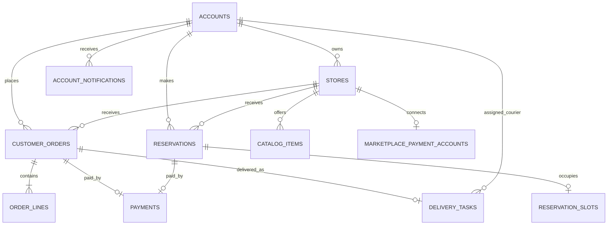

# Modelo de dados do backend

**Banco:** PostgreSQL 17 · **Migrações:** `Backend/src/main/resources/db/migration-common` (V1–V8, V10–V12) e `migration-postgres` (V9); o perfil H2 usa `migration-h2` para V9 (Flyway).

## Entidades e relações

| Tabela | Conteúdo |
|---|---|
| `accounts` | Identidade, e-mail único, hash de senha, perfil/endereço brasileiro, papel, situação e aprovação de acesso operacional. |
| `stores` | Estabelecimento do comerciante, categoria, endereço, imagem de capa, aprovação, comissão configurável e taxa fixa de entrega. |
| `catalog_items` | Produtos ou serviços, preço em centavos, estoque, disponibilidade e indicador de serviço. |
| `customer_orders` | Cliente, loja, modalidade, endereço de entrega, subtotal, taxa de entrega congelada, total e estado. |
| `order_lines` | Snapshot do identificador, nome, quantidade e preço unitário dos itens comprados. |
| `payments` | Pagamento de um pedido ou reserva, dados de checkout/provedor e ciclo de vida de estornos. |
| `reservations` | Serviço, estabelecimento, cliente, horário, valor congelado e estado. |
| `reservation_slots` | Bloqueio único do horário ativo de uma loja, liberado quando a reserva deixa de ocupar o horário. |
| `delivery_tasks` | Oferta/atribuição e progresso de uma entrega associada a pedido de delivery. |
| `account_notifications` | Notificações persistidas e isoladas por conta, com data de leitura. |
| `marketplace_payment_accounts` | Vínculo OAuth da loja com a conta Mercado Pago; tokens são armazenados criptografados. |
| `customer_addresses` | Livro de endereços do cliente, com endereço padrão (V7). |
| `operation_messages` | Mensagens de pedido, reserva ou entrega, com remetente e data (V11). |
| `support_tickets` | Chamados de suporte vinculados a uma conta, assunto, categoria e estado (V12). |
| `support_ticket_messages` | Histórico ordenado de mensagens do chamado, com remetente e data (V12). |
| `platform_requests` | Solicitações de perfil, cidade de operação ou nova loja; registra estado, responsável e decisão (V13). |
| `service_cities` | Cidades liberadas pelo administrador para aparecer na seleção de localização (V13). |
| `recovery_codes` | Hashes de códigos temporários de recuperação/verificação, com validade, tentativas, canal e consumo (V14). |
| `flyway_schema_history` | Versões, checksums e resultado das migrações aplicadas pelo Flyway. |

## Regras de negócio e integridade

- E-mail de conta é único; a busca de identidade não diferencia maiúsculas de minúsculas.
- O CPF obrigatório no cadastro é validado e armazenado em coluna única, separado do UUID da conta. CPF permanece reservado mesmo quando a conta ou um perfil é suspenso; o cadastro nunca cria uma nova identidade para outro tipo de acesso.
- Perfis de cliente, vendedor e entregador pertencem à mesma conta. A solicitação de perfil é revisada pelo administrador; cada decisão aprovada adiciona o perfil à conta sem criar outro usuário.
- A liberação de uma cidade e o cadastro de cada loja são solicitações independentes com histórico de revisão administrativa.
- Novas lojas exigem CNPJ válido e único. O CNPJ fica imutável após o cadastro; lojas adicionais passam pela mesma aprovação individual.
- Valores monetários são inteiros em centavos (BRL), sem aritmética de ponto flutuante.
- Cada loja configura sua própria **taxa fixa de entrega**, cobrada somente em pedidos de delivery. Ela é copiada para o pedido no checkout; uma edição futura do perfil da loja não altera pedidos existentes. O valor permitido atualmente vai de R$ 0,00 a R$ 1.000,00.
- Cada loja também configura a comissão do marketplace em pontos-base (0% a 50%). A comissão e a taxa de entrega são conceitos separados.
- Pedidos guardam snapshots de subtotal, taxa, total e linhas; reservas guardam snapshot do valor do serviço.
- Pagamento pertence exclusivamente a um pedido ou a uma reserva; uma constraint impede ambos (ou nenhum) e há no máximo um pagamento por alvo.
- Um horário de reserva ativo é único por loja no banco. A tabela `reservation_slots` impede disputa concorrente; slots de reserva cancelada/expirada são liberados transacionalmente.
- Notificações são associadas a `account_id`; endpoints autenticados consultam apenas a conta da sessão.
- Solicitações de vendedores e entregadores ficam pendentes até a aprovação administrativa; a conta continua ativa como cliente e `operator_application_status` registra o resultado.
- Solicitações novas de perfil e cidade são serializadas por bloqueio da conta durante a verificação e gravação, reduzindo duplicatas concorrentes da mesma pessoa. Dados de uma loja não podem ser editados enquanto a solicitação estiver pendente.
- Uma loja só é considerada disponível quando está ativa e aprovada e sua conta proprietária está ativa com o perfil de vendedor liberado. Suspender a conta ou o perfil de vendedor também desativa e retira a aprovação das lojas; reativar a conta não republica automaticamente as lojas.
- Cada requisição autenticada valida assinatura, emissor e validade do JWT e consulta se a conta do titular continua ativa; a suspensão administrativa revoga imediatamente o acesso do token existente.
- A atribuição de entregador é feita por atualização condicional atômica: só uma requisição consegue atribuir uma tarefa ofertada e ainda sem entregador.
- Estados de pedido, reserva, pagamento e entrega têm transições controladas no domínio. Pagamentos não confirmam pedidos cancelados sem iniciar o fluxo de estorno.
- Estoque é reservado ao criar pedido; é liberado quando o checkout expira e reposto quando a loja rejeita/cancela o pedido. Itens de serviço não usam estoque.
- O cliente pode cancelar pedido ou reserva antes da aprovação do pagamento; a ação falha/encerra o checkout, libera estoque/horário e avisa a loja. Operações pagas seguem o fluxo de cancelamento/estorno da loja.
- Colunas `version` dão suporte a controle otimista de concorrência em catálogo, pedido, pagamento, reserva e entrega.
- Chaves estrangeiras protegem relações com clientes, lojas, serviços, pagamentos e tarefas.
- Webhooks do Mercado Pago validam assinatura; a rota é publicamente acessível para permitir chamadas do provedor, mas requisições sem assinatura válida não podem atualizar pagamentos.

## Evoluções das migrações V7 a V14

- **V7:** `customer_addresses`.
- **V8:** `delivery_tasks` ganha latitude, longitude e data da localização do entregador.
- **V9:** `accounts` ganha `cpf`, `granted_roles`, `suspended_roles`, `requested_operator_role` e `password_change_required`; `stores` ganha `city` e `state`. Há scripts equivalentes para PostgreSQL e H2, mantendo a mesma versão e os checksums já aplicados no PostgreSQL.
- **V10:** `accounts.credential_version` invalida tokens quando a senha muda.
- **V11:** `customer_note` em pedidos e reservas e a tabela `operation_messages`.
- **V12:** `support_tickets` e `support_ticket_messages`, com vínculo à conta proprietária, estado e autoria de cada mensagem.
- **V13:** coluna única `stores.cnpj`, tabelas `platform_requests` e `service_cities`, com índices por conta/data e estado/data para análise e histórico.
- **V14:** `accounts.phone_verified` e tabela `recovery_codes`. O código em texto puro nunca é persistido; a expiração é de 10 minutos, a contagem de tentativas é limitada e o consumo é registrado.

Contas de operador pendentes continuam ativas como cliente até a aprovação; o acesso profissional só é concedido pelo administrador.

## Estornos

Cancelamento/recusa pela loja de pedido ou reserva já pago gera pedido de estorno integral. A chave de idempotência persistida é reutilizada em tentativas após falha ambígua; tentativas e referência do provedor são registradas em `payments`. Confirmações assíncronas chegam por webhook. Casos que excedem as tentativas ou exigem intervenção entram em `REFUND_REVIEW` para acompanhamento administrativo. O estado do pagamento fica separado do estado do pedido/reserva.

## Limites conhecidos

- Horários de reserva são pontuais; duração, capacidade por profissional/equipe e grade de horários não estão modeladas.
- `order_lines.catalog_item_id` e `reservations.catalog_item_id` preservam o identificador do item como snapshot, sem FK que impediria removê-lo do catálogo.
- O estorno automático precisa de homologação com credenciais reais/de teste do Mercado Pago. Em Marketplace Split 1:1, saldo insuficiente na conta do vendedor pode exigir ação manual no provedor.
- Conciliação contábil/liquidação, chargebacks, saque Pix iniciado pela plataforma e cancelamento iniciado pelo cliente ainda não fazem parte do modelo implementado.
- Capas são gravadas em armazenamento de arquivos configurável; o banco mantém somente `stores.cover_image_url`.
